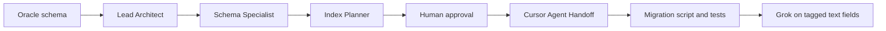

# Product contract

Enterprise Data Modernization and Migration Accelerator. The demo starts from an Oracle schema. The Lead Architect reads that schema. The later bots convert the reading into the equivalent MongoDB schema, its indexes, and the batch that loads it.

The architect time this replaces is the judgment about which tables share a document, which stay referenced, which indexes exist because a query needs them, and which free-text fields are safe to rewrite. The pipeline records that judgment. It does not invent a second one at code-generation time.

## Users

- **Migration architect.** Attaches the Oracle schema and the access paths in the Migration review group. Reviews the MongoDB schema. Is the only person who can approve a handoff.
- **Lead Architect.** Reads the Oracle schema into the relational model. Uses Oracle skills for that read only.
- **Schema Optimization Specialist.** Converts that reading into the MongoDB document model and field mapping, using MongoDB schema skills.
- **Performance & Indexing.** Adds the MongoDB indexes for that document model, using MongoDB indexing skills.
- **Cursor Agent Handoff.** After the architect approves in the group, starts one Cursor cloud agent that loads the MongoDB schema. The agent uses MongoDB connection and validation skills. It does not redesign the model.

The four stages are four Grok Bots in one Migration review group. Each bot has one skill enabled, replies in that group, and speaks only when @mentioned. They share one spec.

| Bot | Skill to enable |
| --- | --- |
| Lead Architect | [lead-architect](../.cursor/skills/lead-architect/SKILL.md) |
| Schema Optimization Specialist | [schema-optimization](../.cursor/skills/schema-optimization/SKILL.md) |
| Performance & Indexing | [performance-indexing](../.cursor/skills/performance-indexing/SKILL.md) |
| Cursor Agent Handoff | [cursor-agent-handoff](../.cursor/skills/cursor-agent-handoff/SKILL.md) |

In Grok Bot, open Connect apps, open Private skills, and enable that skill on that bot only. Ask the bot to save the skill file above if it is not in the library yet.

Also enable the matching official skill. Oracle skills come from [oracle/skills](https://github.com/oracle/skills) (`npx skills add oracle/skills/db`) and are enabled on the Lead Architect only, for reading the schema. MongoDB skills come from [MongoDB Agent Skills](https://github.com/mongodb/agent-skills). In Grok, install `mongodb-atlas` from the marketplace and enable them on the conversion bots only.

| Bot | Official skill | Job |
| --- | --- | --- |
| Lead Architect | `db/agent/schema-discovery.md` and `db/sqlcl/sqlcl-ddl-generation.md` | Read the Oracle schema |
| Schema Optimization Specialist | `mongodb-schema-design` | Convert it to the MongoDB document model |
| Performance & Indexing | `mongodb-query-optimizer` | Index that MongoDB schema |
| Cursor Agent Handoff | `mongodb-connection` and `mongodb-schema-design` validation | Load the approved MongoDB schema |

## Pipeline

Each stage appends only the sections it owns. Once the next stage starts, earlier sections are immutable. A later stage that needs a change stops and sends the spec back. It does not edit the earlier section in place.

| Stage | Writes | Reads |
| --- | --- | --- |
| Lead Architect | `relationalModel`, including `accessPaths` | Oracle schema and access paths |
| Schema Optimization Specialist | `documentModel`, `fieldMapping` | `relationalModel` |
| Performance & Indexing | `indexPlan` | `relationalModel.accessPaths`, `documentModel`, `fieldMapping` |
| Migration architect | `approval` | The four sections above |
| Cursor Agent Handoff | Script, tests, and `runs/<specHash>/`, through one Cursor cloud agent | The approved spec, its skill, and the project rule |

## Migration Spec

The spec is the product. Normative fields are in [spec-format.md](spec-format.md). The five sections:

1. **Relational model.** Tables, columns, keys, nullability, and a cardinality note when the dump provides one. Access paths live here because they are source input, owned by the Lead Architect, and frozen before any index is chosen.
2. **Document model.** One decision per relationship: embed, reference, or polymorphic. Polymorphic is for variants of one entity that share queries (product types, event types), with a discriminator. Each decision records why, plus risks: unbounded arrays, documents that can approach 16MB, and data written on a different cadence than the parent. An embed may be a point-in-time snapshot when a stated access path needs those fields on the parent and the source values must stay as they were at write time.
3. **Index plan.** An index is created only for an access path on the spec. Each index names the query it serves. A point read already covered by the default `_id` index is recorded with `create: false`. When no access path was provided, the plan says so and proposes nothing for the script to create.
4. **Field mapping.** Column to document path. Unstructured fields carry a closed JSON shape. Grok runs only on mappings whose transform is `grok`.
5. **Approval record.** Who approved, what they changed, and the spec hash the cloud agent is allowed to implement.

## Human gate

The Index Planner stops when `indexPlan` is complete. `approval.status` is `pending`. Nothing is handed to a cloud agent until a person sets `approved`.

The architect reviews three things:

- Every relationship decision and the risks recorded on it.
- Every index, the access path it serves, and whether `create` is true.
- Every `grok` mapping and its closed target shape.

The architect may edit any section before approving. Each edit is listed in `approval.changes`. On approval, `approval.specHash` is the SHA-256 of the canonical JSON of the spec excluding `approval`, as defined in [spec-format.md](spec-format.md). A rejected spec has no hash and is not handed off.

The cloud agent receives the hash. It implements that spec only. If the spec in the working tree hashes differently, the agent stops. The agent writes a batch migration and tests. It adds no collection, index, or Grok call the spec does not name. When those tests finish, the run is logged under `runs/<specHash>/<loggedAt>/`: the hash, the approved spec, the test files, and the results. A new hash is a new directory.

Grok output is validated against the mapping's target shape before any write. A value that fails validation sends that source row to the reject file. The row is not written to the target collection.

When a handoff exists, it is a Cursor cloud agent (Cursor SDK cloud runtime, or the Cloud Agents API) against a GitHub repo that already contains the spec, the skills, and the rules. Local Cursor is where those skills and rules are authored.

## Graded example

[fixtures/order-management/](../fixtures/order-management/) is the eval for this slice.

A reader who has not seen the design conversation takes `source.sql` and `queries.md`, follows the project skills, and produces a spec that agrees with `expected-spec.md` on these decisions:

- Orders embed their lines, and embed a snapshot of the customer identity the order-by-id access path needs.
- Products are one polymorphic collection with a `type` discriminator.
- Addresses stay referenced, because a customer accumulates them without a stated upper bound.
- `orders.notes` is the only Grok field, and its output must match the closed shape in the expected spec.

A mismatch on those decisions is a defect in the spec format or the skills, and is fixed there.

## Out of scope for this slice

- ERD and other image uploads. This slice accepts SQL DDL plus a written access-path list.
- Real-time BI, change streams, and dashboards. The outcome of this slice is a document model and a batch load.
- A live multi-agent orchestrator, a UI, and a running Grok batch.
- Indexes inferred from table or column names when no access path asks for them.
- Grok choosing a document shape, a collection layout, or a target JSON shape. The shape is written in the spec before any batch runs.
